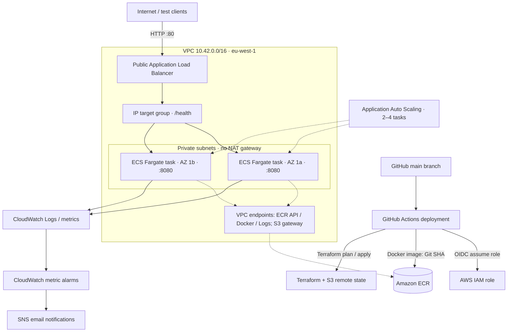
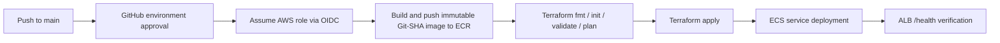

# AWS Enterprise Platform | Terraform • ECS Fargate • GitHub Actions

> **Project status:** Deployed and validated in `eu-west-1`. ECS task replacement, Multi-AZ placement, health endpoint, monitoring alarms, SNS email delivery and autoscaling **configuration** have been verified. Actual CPU-triggered scale-out is **not yet validated**.

A hands-on AWS platform engineering project demonstrating infrastructure as code, keyless CI/CD authentication, private container networking, operational observability, and evidence-driven resilience testing.

## Architecture



*Logical diagram, not an assertion of permanent one-task-per-AZ placement. The placement shown was observed during testing. Traffic is currently HTTP; TLS/ACM is intentionally out of scope.*

### CI/CD deployment flow



## Platform design

| Layer | Implementation |
|---|---|
| Infrastructure as code | Terraform modules; remote S3 state |
| Delivery | GitHub Actions, OIDC IAM role, environment approval, Git SHA image tags |
| Network | VPC, two public and two private subnets across `eu-west-1a` and `eu-west-1b` |
| Ingress | Internet-facing ALB, HTTP listener on port 80, target health check `/health` |
| Compute | ECS Fargate service, desired count 2, application port 8080 |
| Image registry | Amazon ECR with immutable tags |
| Private connectivity | ECR API, ECR Docker and CloudWatch Logs interface endpoints; S3 gateway endpoint; no NAT gateway |
| Observability | CloudWatch ECS CPU/memory metrics, ALB health and HTTP 5xx alarms, SNS notifications |
| Scaling | Application Auto Scaling target tracking: CPU 60%, memory 75%; minimum 2, maximum 4 |

## Verified operational evidence

These results were captured during manual validation on **22 November 2026**. Values are point-in-time observations, not continuous uptime or performance guarantees.

### 1. ECS automatic task recovery

One ECS task was deliberately stopped using `aws ecs stop-task`. During recovery, the service showed:

```text
Desired  Running  Pending
2        1        1
```

After stabilization:

```text
Desired  Running  Pending
2        2        0
```

The original `eu-west-1a` task remained running and a new task appeared in `eu-west-1b`:

```text
Availability Zone   Status    Task ID
------------------  --------  --------------------------------
eu-west-1a          RUNNING   b4c3bdb849e5480c837d49c518affd13
eu-west-1b          RUNNING   53fab5ab72e146b991332b2abcc8c00b
```

**Conclusion:** ECS restored the configured task count automatically, with two AZs represented after recovery. This does **not** prove uninterrupted service during replacement or full-AZ failure recovery.

### 2. Application health after recovery

```http
GET http://aep-primary-alb-1152951062.eu-west-1.elb.amazonaws.com/health
HTTP/1.1 200 OK
Content-Type: application/json

{"status":"healthy"}
```

**Conclusion:** The ALB endpoint responded successfully *after* recovery.

### 3. Autoscaling registration and policies

```text
Resource                                            Min  Max
service/aep-primary-cluster/aep-primary-service      2    4

Policy                         Type                   Target
aep-primary-cpu-scaling        TargetTrackingScaling   60%
aep-primary-memory-scaling     TargetTrackingScaling   75%
```

**Conclusion:** Scaling target and policies exist. No CPU-driven increase to 3–4 running tasks has been demonstrated yet.

### 4. CloudWatch alarm health and SNS delivery

```text
Alarm                            State
aep-primary-alb-5xx              OK
aep-primary-ecs-high-cpu         OK
aep-primary-ecs-high-memory      OK
aep-primary-target-5xx           OK
aep-primary-unhealthy-targets    OK
```

The high-CPU alarm was manually placed in `ALARM` state with `aws cloudwatch set-alarm-state`; a notification email was received via SNS.

**Conclusion:** Alarm configuration and alarm-to-email delivery were verified. The manual alarm test did not simulate real CPU pressure.

### 5. HTTP load-test results

A Python `urllib.request` client in AWS CloudShell issued requests to the `/health` endpoint.

| Test | Requests | Successful | Failed | Duration | Reported throughput |
|---|---:|---:|---:|---:|---:|
| Initial connectivity burst | 100 | 100 | 0 | 0.19 s | 519.34 req/s |
| Larger burst | 10,000 | 9,989 | 11 | 28.59 s | 349.74 req/s |

**Observed success rate for the larger burst: 99.89%.** The 11 failed requests were not categorized by the script, so their causes remain unknown. These are short client-side test results, **not** production capacity benchmarks or an availability SLA.

### 6. ECS CPU metrics during load

| Measurement | Approximate utilization |
|---|---:|
| Typical pre-test one-minute average | 0.32% |
| Highest observed one-minute average | 2.80% |
| Highest observed one-minute maximum | 15.23% |
| CPU target tracking set point | 60% |

**Conclusion:** CPU increased under traffic but did not approach the configured target. No scale-out was expected from this short, lightweight `/health` workload.

## How to reproduce the verification

Prerequisites: deployed platform, AWS CLI credentials authorized for ECS/CloudWatch/Application Auto Scaling, and access to the ALB endpoint. Run read-only checks first.

```bash
# Service capacity
aws ecs describe-services \
  --cluster aep-primary-cluster \
  --services aep-primary-service \
  --region eu-west-1 \
  --query 'services[].{Desired:desiredCount,Running:runningCount,Pending:pendingCount}'

# Scaling limits
aws application-autoscaling describe-scalable-targets \
  --service-namespace ecs --region eu-west-1 \
  --query 'ScalableTargets[].{Resource:ResourceId,Min:MinCapacity,Max:MaxCapacity}'

# Scaling policies
aws application-autoscaling describe-scaling-policies \
  --service-namespace ecs \
  --resource-id service/aep-primary-cluster/aep-primary-service \
  --region eu-west-1

# Alarm state
aws cloudwatch describe-alarms \
  --alarm-name-prefix aep-primary --region eu-west-1 \
  --query 'MetricAlarms[].{Name:AlarmName,State:StateValue}' --output table

# HTTP health
curl -i http://aep-primary-alb-1152951062.eu-west-1.elb.amazonaws.com/health
```

Task stopping, manual alarm transitions and load tests are **disruptive/active** operations; perform them only in an authorized test environment and monitor results.

## Security and operational boundaries

- **HTTP only:** ACM, HTTPS and custom-domain TLS are deferred; do not send sensitive data through the public endpoint.
- **No NAT gateway:** Private tasks rely on configured VPC endpoints; arbitrary public internet egress is not available.
- **Deployment permissions:** GitHub Actions uses short-lived OIDC credentials instead of long-lived IAM access keys.
- **Health check scope:** `/health` proves the HTTP handler responds, not the health of every dependency.
- **Costs:** Fargate, ALB, VPC interface endpoints, CloudWatch and data transfer can incur charges. Autoscaling allows up to four tasks.
- **Availability:** Multi-AZ placement was observed; zero-downtime and full-AZ recovery are not yet proven.

## Deferred security controls and production hardening

This is an **engineering demonstration environment**, not a claim of production security certification. The table distinguishes features deliberately excluded from this iteration from controls whose configuration **has not been verified**. “Not verified” does not mean absent.

| Control | Current scope / evidence | Production consideration |
|---|---|---|
| **AWS WAF** | **Deferred** — no WAF web ACL or ALB association was included in this implementation | Add managed rule groups, rate-based rules, logging and tuning for internet-facing applications |
| **ACM certificate + HTTPS** | **Intentionally deferred** — public ALB currently listens on HTTP `:80` | Use a validated domain, ACM certificate, HTTPS `:443`, and HTTP-to-HTTPS redirect; consider TLS to targets when required |
| **AWS Shield Advanced** | **Not implemented as part of this project** | Evaluate only if risk and business requirements justify it; AWS Shield Standard protection is provided automatically for supported AWS resources |
| **ALB access logs** | **Not verified** | Enable delivery to a controlled S3 bucket for request investigation and audit retention |
| **VPC Flow Logs** | **Included in the network design**; retention, alerting and analysis have not been validated here | Verify log destination, retention, access controls and detection use cases |
| **AWS CloudTrail** | **Account-level trail configuration not verified** | Verify organization/account audit coverage, encryption, retention and alerting |
| **AWS Config / Security Hub / GuardDuty** | **Not verified** in this project's account | Evaluate configuration compliance, security posture and threat detection according to account governance |
| **ECR image scanning** | **Scan-on-push is configured**; scan findings and remediation process have not been validated | Review vulnerability findings, block risky releases where appropriate and add dependency/image checks to CI |
| **Secrets Manager / SSM Parameter Store** | **Application secret-management integration not demonstrated** | Store secrets outside code and images; use least-privilege task roles and rotation where applicable |
| **IAM least privilege** | **OIDC deployment role is used**; complete policy review has not been performed | Scope deployment, task execution and task roles to the minimum actions and resources required |
| **Encryption and key management** | **End-to-end encryption and key policy review not completed** | Verify encryption at rest for state, logs, registry and other stores; use TLS in transit as appropriate |
| **Remote Terraform state protection** | **S3 remote backend is used**; versioning, locking, encryption and access-policy settings are not verified in this README | Validate state access restrictions, encryption, recovery and locking configuration |
| **Public API authentication / rate limiting** | **Not implemented for the demo `/health` endpoint** | Add authentication/authorization to protected APIs and request throttling or WAF rate controls as appropriate |
| **Private application egress** | **No NAT gateway**; AWS service endpoints are configured | Review egress rules and any additional endpoints required by application dependencies |
| **Resilience / disaster recovery** | **Task-level self-healing demonstrated**; no full-AZ failure or regional DR exercise | Test AZ outage scenarios, backups and recovery objectives before claiming broader resilience |

### Security design decision

The public endpoint serves a non-sensitive demonstration health response. **Do not send credentials, personal information or confidential data over HTTP.** Security controls were scoped to the learning objective and cost of the demo, not assessed as sufficient for a real production workload.

The most immediate production blockers are **unencrypted public HTTP**, lack of a demonstrated application access-control strategy, and unverified security monitoring and audit coverage. WAF and the other deferred controls should be selected using an explicit threat model rather than added only to increase the number of AWS services.

## Next validation milestones

- [x] Deploy application on private ECS Fargate behind ALB
- [x] Validate two running tasks across two AZs
- [x] Stop a task and verify automatic replacement
- [x] Verify ALB `/health` returns HTTP 200 after recovery
- [x] Register autoscaling target and CPU/memory policies
- [x] Verify CloudWatch alarms and SNS email notification
- [x] Run and record short HTTP load tests
- [ ] Investigate failed load-test requests with categorized errors and ALB metrics
- [ ] Validate actual CPU-triggered scale-out and scale-in under a controlled workload
- [ ] Measure request availability continuously during task replacement
- [ ] Add HTTPS/ACM when a domain and TLS deployment are in scope
- [ ] Evaluate WAF managed rules and rate limiting for public ingress
- [ ] Review ALB access logging, CloudTrail, GuardDuty, Config and Security Hub coverage
- [ ] Validate IAM permissions, state security, encryption and ECR vulnerability remediation

## Repository layout (logical)

```text
.github/workflows/terraform-deploy.yml
app/
  Dockerfile
  main.py
  requirements.txt
environments/primary/
modules/
  ecs-fargate/
  monitoring/        # monitoring Terraform added in the current phase
scripts/              # optional local availability/load-test helpers
```

*This README documents the deployed design and observed CLI evidence. Confirm exact paths, module names, and current configuration against the live repository before committing it.*
